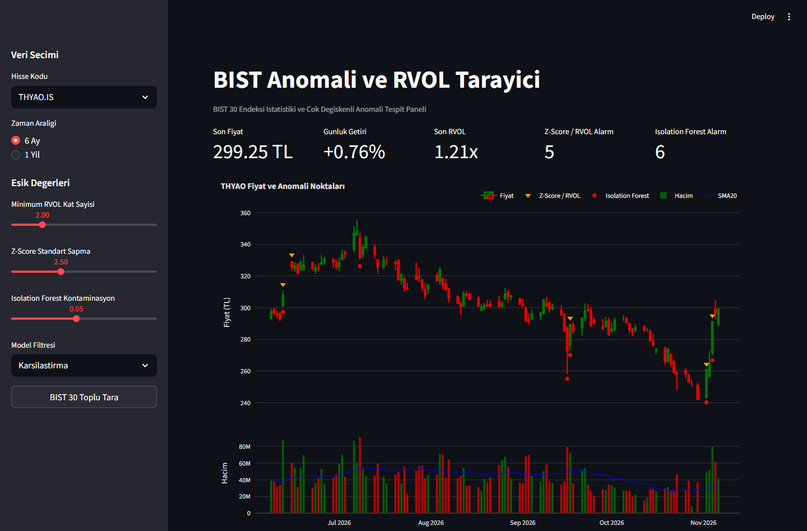
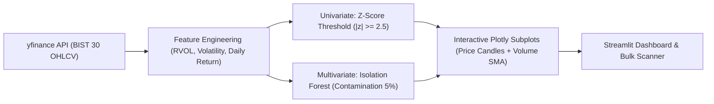

# BIST 30 Outlier & RVOL Scanner 📈

An algorithmic data pipeline and interactive visualizer for detecting statistical and multi-dimensional machine learning anomalies across **Borsa İstanbul (BIST 30)** equities.



---

## 🎯 Motivation

A frequent pitfall in student finance projects is attempting to predict future stock prices using regression or LSTM models—markets are heavily non-stationary, noisy, and fundamentally driven by exogenous variables.

Instead of futile price prediction, this project focuses on **quantitative anomaly detection**:
- Pinpointing sudden institutional inflows / abnormal volume surges (**RVOL**).
- Isolating tail-risk price volatility and abnormal return days.
- Comparing classical univariate statistical filtering (**Z-Score**) against multivariate unsupervised anomaly detection (**Isolation Forest**).

---

## ⚙️ Core Architecture & Methodology



### 1. Feature Engineering

* **Relative Volume (RVOL):** Measures institutional positioning relative to the trailing 20-day baseline.

$$ \text{RVOL}_t = \frac{\text{Volume}_t}{\text{SMA}_{20}(\text{Volume})} $$

* **Intraday Volatility:** Quantifies the intraday high-to-low range normalized by the close.

$$ \text{Volatility}_t = \frac{\text{High}_t - \text{Low}_t}{\text{Close}_t} $$

* **Daily Percentage Return:** Day-over-day close-to-close percentage change.

$$ \text{Return}_t = \left(\frac{\text{Close}_t - \text{Close}_{t-1}}{\text{Close}_{t-1}}\right) \times 100 $$

### 2. Dual-Engine Anomaly Detection
1. **Classical Statistical Model (Z-Score):**
   * Flags data points exceeding 2.5 standard deviations from the rolling mean on return or volume, or RVOL $\ge 2.0$.
2. **Unsupervised ML Model (Isolation Forest):**
   * Operates on a 3-dimensional vector space $(\text{RVOL}, \text{Volatility}, \text{Return})$.
   * Isolates anomalous clusters without assuming a normal distribution, identifying subtle non-linear market dislocations.

---

## 🚀 Getting Started

### Prerequisites
* Python 3.10+
* Virtual environment (optional but recommended)

### Installation

```bash
git clone https://github.com/semih-aydin/BIST-Outlier-Volatility-Scanner.git
cd BIST-Outlier-Volatility-Scanner
pip install -r requirements.txt
```

### Running the Dashboard

```bash
streamlit run app.py
```

The application will launch locally at `http://localhost:8501`.

---

## 📊 Features & Views

* **Single Stock Deep Dive:** Select any BIST 30 ticker (`THYAO.IS`, `ASELS.IS`, `GARAN.IS`, etc.) to view interactive dual-axis Plotly charts:
  * Top Panel: OHLC Candlestick chart overlaid with Z-Score and Isolation Forest warning diamonds/stars.
  * Bottom Panel: Volume bars color-coded by RVOL intensity with 20-day SMA guide.
* **BIST 30 Macro Scanner:** Automatically ingests and scans all 30 index equities, ranking tickers by total anomaly signals generated over the trailing 7-day window.

---

## 🛠️ Tech Stack

* **Language:** Python 3.11+
* **Data Ingestion:** `yfinance`
* **Data Processing:** `pandas`, `numpy`
* **Machine Learning:** `scikit-learn` (IsolationForest)
* **Visualization:** `plotly` (Graph Objects & Subplots)
* **UI Framework:** `streamlit`

---

## 👤 Author

**Semih Aydın**  
* GitHub: [@semih-aydin](https://github.com/semih-aydin)
* LinkedIn: [semihaydin61](https://linkedin.com/in/semihaydin61)
